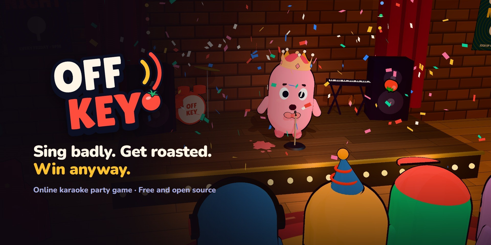
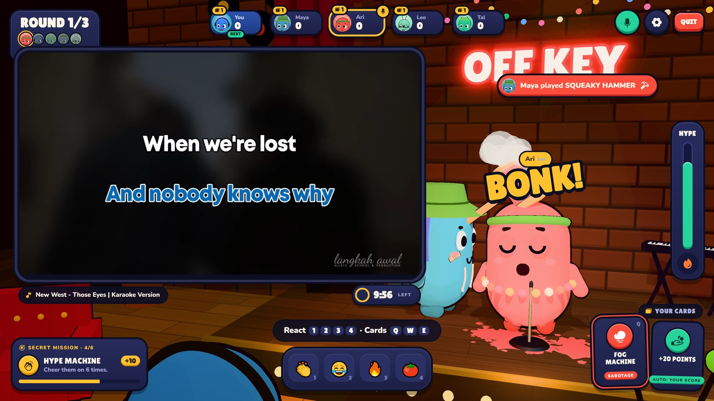
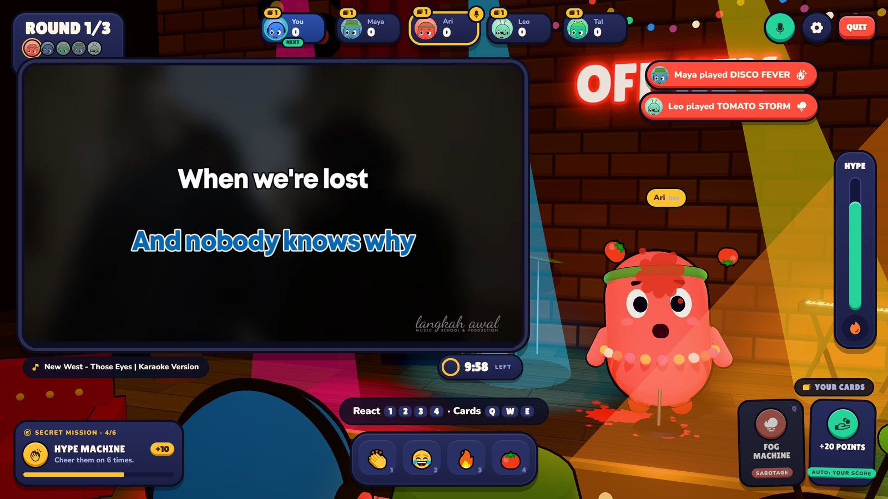
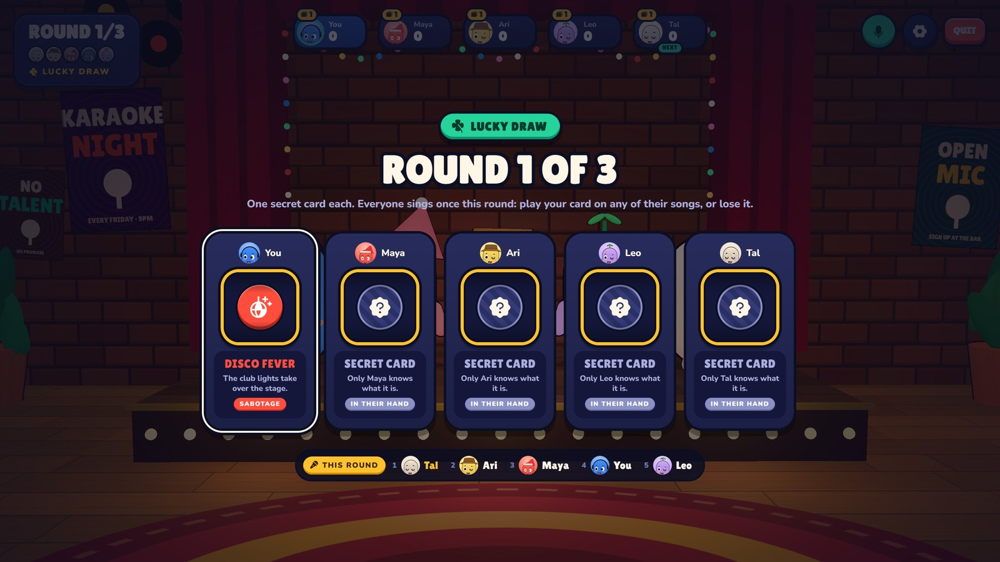
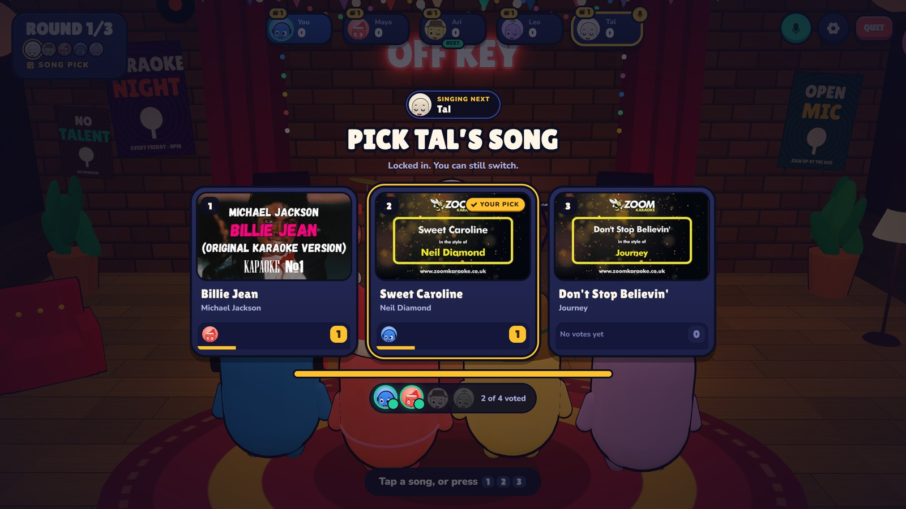
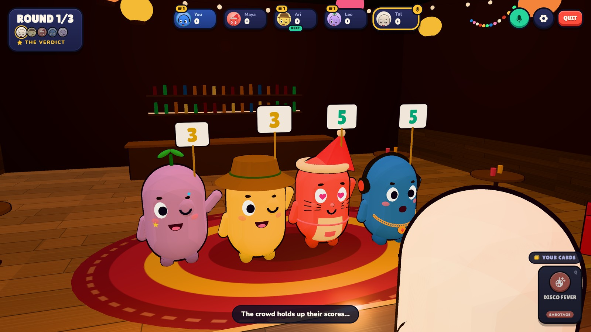
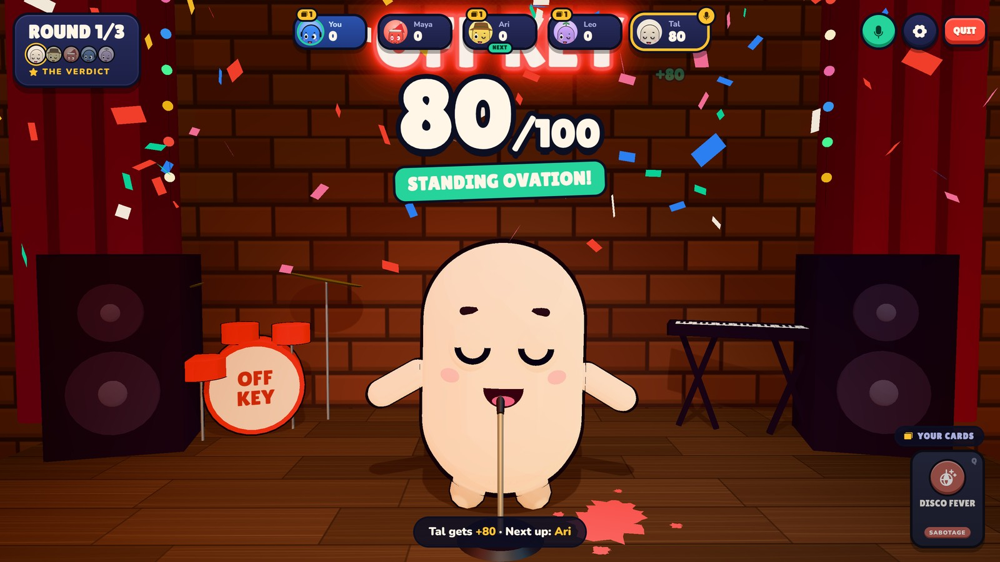
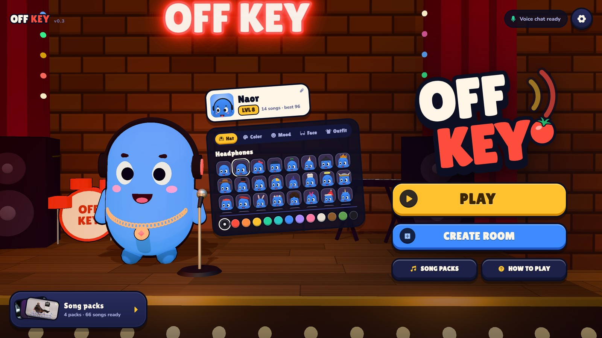
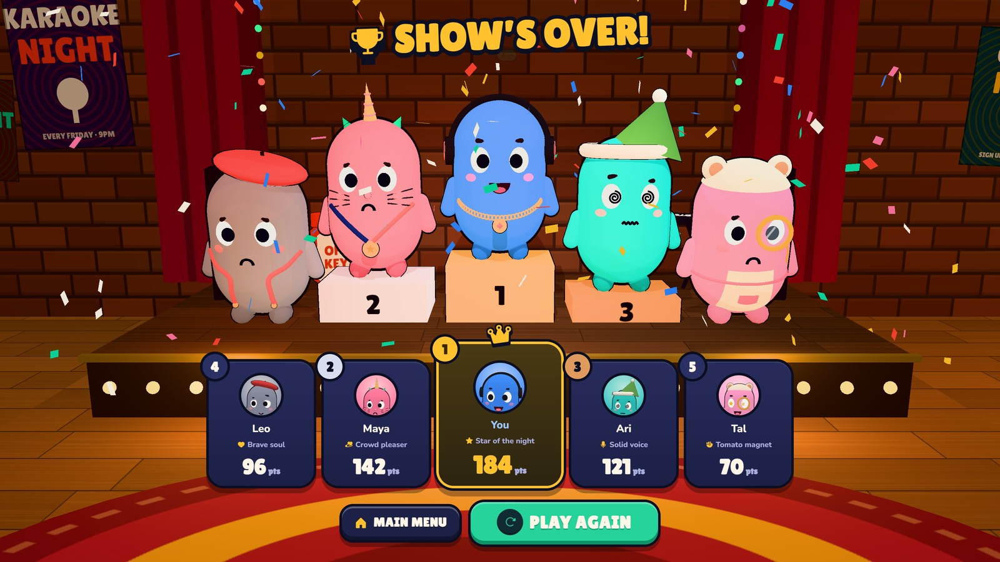
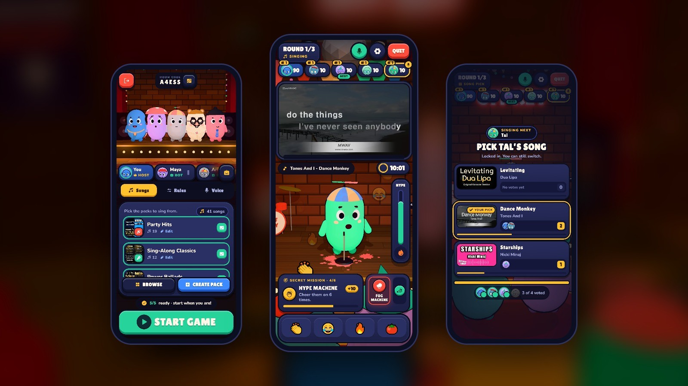

# Off Key

A karaoke party game for 2-6 friends, played in the browser. Everyone takes the stage in a 3D karaoke bar and sings along to YouTube karaoke videos, while the crowd cheers, throws tomatoes and plays sabotage cards on them. Then they vote. Most points after the last round wins.

Nothing to download for players: one person runs the server, everyone else opens a link. It works on phones too.



| | |
|---|---|
|  |  |
|  |  |
|  |  |
|  |  |

## Features

- Sing with real karaoke videos. The video plays in sync for everyone, so the singer's voice and the music line up for the whole room.
- Voice chat built in. The singer is mixed on top of the music, and the music dips whenever they sing.
- The room picks your song: three choices, everyone votes, and you sing whatever wins.
- A Lucky Draw opens every round and deals everyone a secret card. 25 cards in all: sabotage the singer with Lights Out, Fog Machine, Speed Up, Robot Voice, Earthquake or a Squeaky Hammer, or land Jackpots, Double Ups and Golden Votes.
- Secret crowd missions while someone sings, like "laugh 4 times" or "react before anyone else". No talking needed.
- Reactions, a hype meter and tomatoes that actually stick.
- Secret 1-5 votes, score cards held up by the crowd, and bonus points for judging close to the room.
- A wardrobe with 38 hats, 20 moods, 18 face extras and 18 outfits, in any color.
- Song packs you can build yourself: paste YouTube karaoke links and mark where the singing starts.
- Plays on phones, held upright or sideways.



## Requirements

- [Node.js](https://nodejs.org) 20 or newer, on the computer that runs the server
- Chrome or Edge for everyone who plays (on phones, any modern browser)
- Headphones for whoever is singing, or their mic picks up the music
- A [LiveKit](https://livekit.io) project for voice chat. The free plan is enough to play with friends.

Without LiveKit keys the game still runs, just without voice.

## Install

```bash
git clone https://github.com/NaorX/off-key-karaoke.git
cd off-key-karaoke
npm install
```

Copy the example config and add your LiveKit keys:

```bash
cp .env.example .env
```

On Windows use `copy .env.example .env`. Then open `.env` and paste the URL, key and secret from your LiveKit project's settings.

## Run

```bash
npm start
```

Open http://localhost:5180 and allow the microphone when the browser asks.

## Playing with friends

One player hosts: **Create Room**, then **Copy Link** in the lobby and send it to your friends. They just open the link, nothing to install.

They need to reach the machine that runs the server:

- **Same network:** have them open `http://YOUR-LOCAL-IP:5180`.
- **Over the internet:** expose the port with a tunnel, for example `ngrok http 5180`, and share that link.

The host sets the rules in the lobby: rounds, song length, how loud the crowd is while someone sings, cards, tomatoes and missions. You can add bots to fill the room.

## Controls

| Key | |
|---|---|
| 1 2 3 4 | React: applause, laugh, fire, tomato |
| Q W E | Play a sabotage card |
| 1 2 3 | Pick a song |
| 1 to 5 | Vote |
| Enter | I'm ready, when it's your turn |
| M | Mute your mic |

On a phone everything is a tap.

## Song packs

Four packs come with the game: Party Hits, Sing-Along Classics, Power Ballads and a Hebrew pack, 64 songs in all, each marked by hand with where the singing starts, where the chorus starts and where it ends. Short rounds start at the chorus.

To make your own, open **Song Packs** and **Create My Pack**, paste YouTube karaoke links and set the start of each song. Some channels block their videos from playing outside YouTube; the editor checks every link and tells you.

Songs play from YouTube. The game doesn't host any music.

## Configuration

All settings live in `.env`.

| Variable | |
|---|---|
| `LIVEKIT_URL` | Your LiveKit project URL, `wss://...` |
| `LIVEKIT_API_KEY` | LiveKit API key |
| `LIVEKIT_API_SECRET` | LiveKit API secret |
| `PORT` | Server port. Default 5180. |
| `OFFKEY_TEST_CLIP` | Makes every song this many seconds long, for quick test runs. |

## Project layout

| Folder | |
|---|---|
| `client/js/scene.js` | The 3D karaoke bar, the characters and the camera |
| `client/js/main.js` | Screens, menus and the game HUD |
| `client/js/karaoke.js` | Keeps everyone's YouTube player on the same clock |
| `client/js/voice.js` | Voice chat, the singer's mix and the sabotage voice effects |
| `client/js/powers.js` | The cards, shared by the server and the browser |
| `client/js/missions.js` | The crowd missions, shared by the server and the browser |
| `server/rooms.js` | Rooms and the game loop. The server owns the state and the clock. |
| `server/seed.js` | The song packs a new install starts with |

The characters are built from code and all the sounds are synthesized, so there are no asset files.

## Contributing

Issues and pull requests are welcome.

## License

MIT, see [LICENSE](LICENSE).
